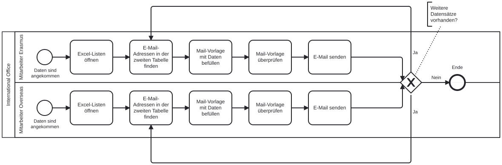
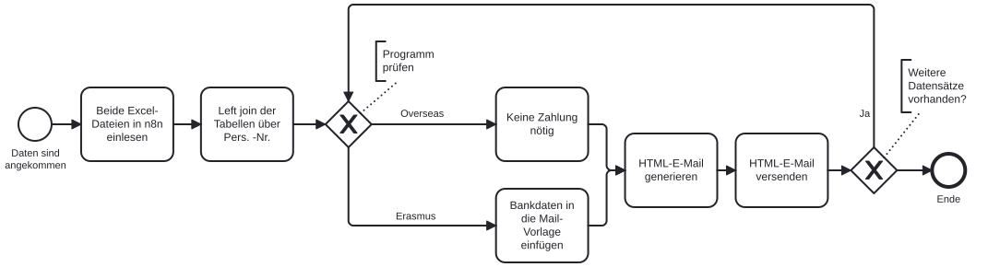

# Process Automatisation International Office
## Ausgangslage & Problem
Im International Office der Philipps-Universität-Marburg musste die Zimmerzuteilung für Austauschstudierende manuell durchgeführt werden.

Das Problem: Die Daten lagen in zwei getrennten Excel-Listen vor. Mitarbeiter mussten die E-Mail-Adressen manuell anhand der Personalnummer (Pers.-Nr.) suchen.
Es gab massive Medienbrüche bei der Erstellung der E-Mails wegen unterschiedlicher Vorlagen für Erasmus und Overseas. Der Prozess war zeitaufwändig und fehleranfällig.
### Ist-Zustand (Manueller Prozess mit Medienbrüchen)

Zwei Mitarbeiter, getrennte Listen, manuelle E-Mail-Erstellung
## Zielsetzung
Entwicklung eines automatisierten Workflows zur Zusammenführung der Daten, dynamischen Generierung von zweisprachigen E-Mails (DE/EN) und automatischen Zustellung via SMTP ohne manuellen Eingriff.
## Wirtschaftlichkeitsbetrachtung
**Ist-Zustand (Manueller Prozess):**
Die Vorbereitung (Öffnen der zwei Excel-Tabellen und der E-Mail-Vorlage) dauert ca. 1 Minute. Für jeden Studierenden werden ca. 3 Minuten zum Ausfüllen der Vorlage sowie 30 Sekunden für die Qualitätskontrolle benötigt. Das ergibt 3,5 Minuten pro Person (= 0,0583 Stunden).

Bei einem Stundenlohn einer studentischen Hilfskraft von 14,50 € kostet die Benachrichtigung eines Studierenden 0,84 €.
Ausgehend von 400 Austauschstudierenden pro Jahr (200 pro Semester) bedeutet das für die Universität einen reinen Verwaltungsaufwand von 23,33 Stunden bzw. 338 € pro Jahr (bei Einsatz einer studentischen Hilfskraft, deren Stundensatz etwa die Hälfte eines festangestellten Mitarbeiters beträgt).

**Soll-Zustand (Automatisierter Prozess):**
Durch den automatisierten n8n-Workflow reduziert sich der Aufwand auf ca. 2 Minuten pro Durchlauf (hauptsächlich für den Start und die finale Kontrolle). Bei zwei Durchläufen pro Jahr sind das lediglich 4 Minuten.

**Ergebnis:**
Die benötigte Zeit sinkt von 23,33 Stunden auf 4 Minuten pro Jahr. Das entspricht einer Reduzierung des manuellen Aufwands um 99,4% und einer Beschleunigung des Prozesses um das 350-fache. Die Universität spart dadurch jährlich über 23 Stunden Arbeitszeit und mindestens 336 € Personalkosten für repetitive, fehleranfällige Tätigkeiten.

### Soll-Zustand (Automatisierter n8n-Workflow)

Automatisches Mergen, dynamische Logik für Erasmus/Overseas, Loop für alle Datensätze
## Technische Umsetzung

Die Business-Logik ist in der Datei email_generator.py implementiert.
